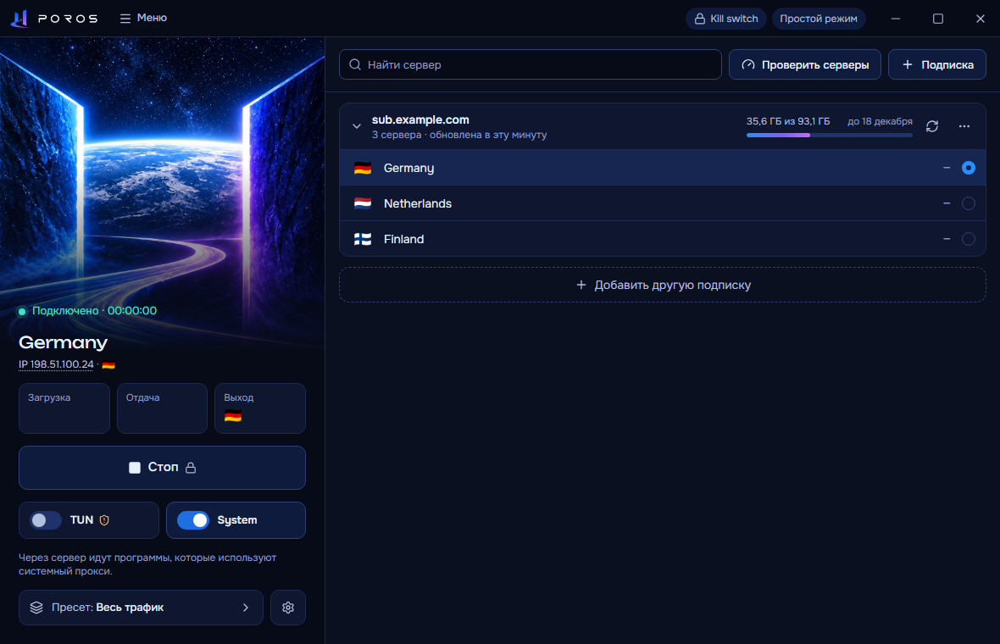
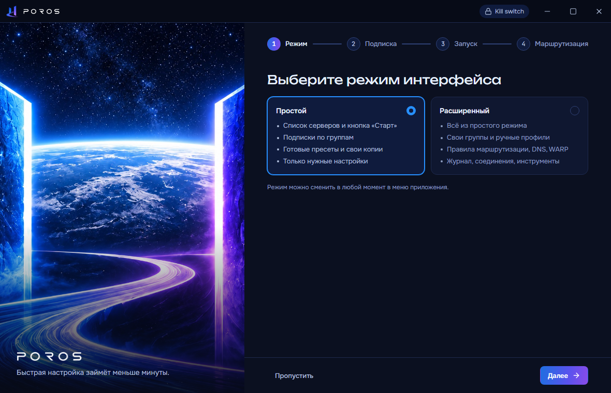
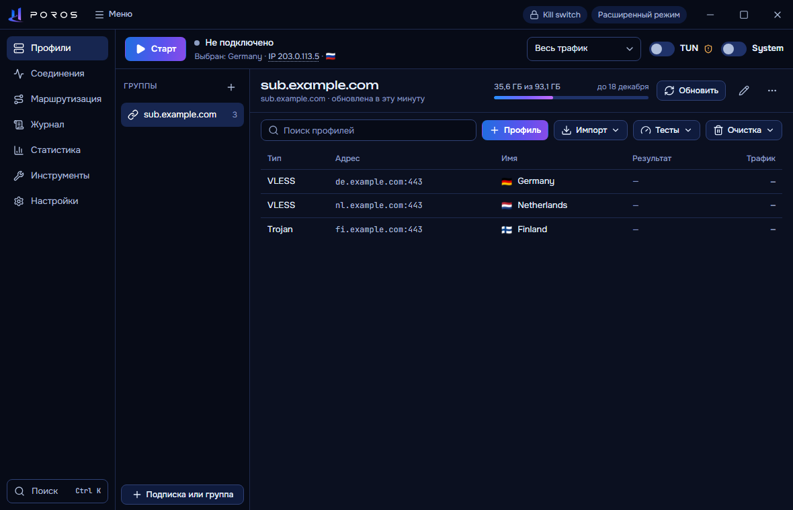
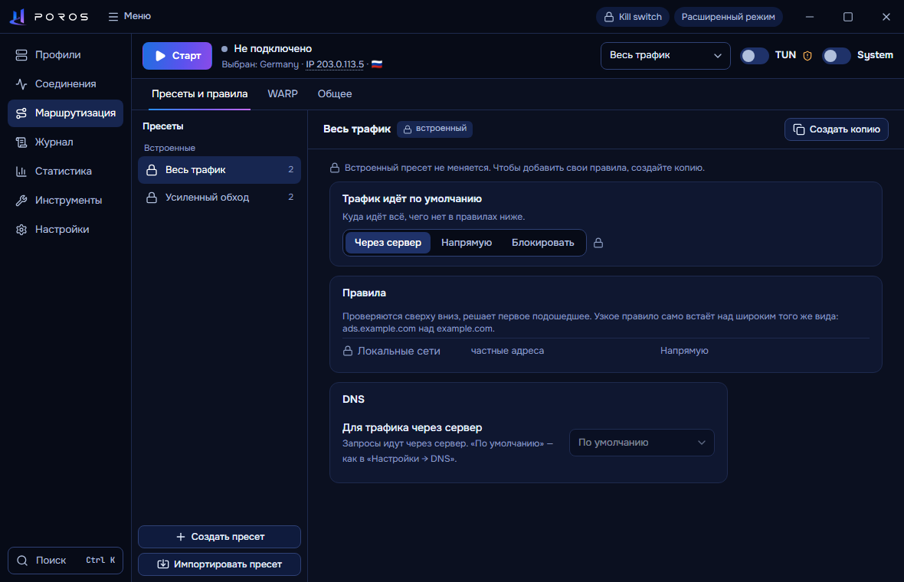
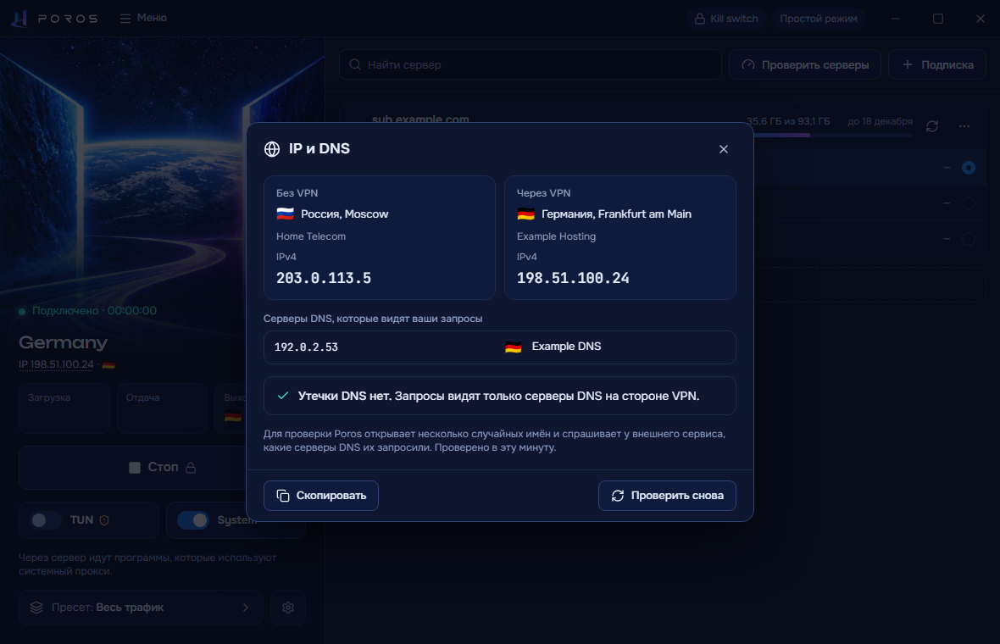

<div align="center">


# Project Poros

**A portable VPN and proxy client for Windows**<br>
on [sing-box](https://github.com/SagerNet/sing-box) and [Xray-core](https://github.com/XTLS/Xray-core), with a simple mode for every day and an advanced one with every setting

[](https://github.com/tergride/poros/releases/latest)
[](https://github.com/tergride/poros/releases)
[](#download)
[](LICENSE)

**English** · [Русский](README.ru.md)

[Download](#download) · [What it does](#what-it-does) · [For developers](#for-developers) · [License](#license)



</div>

## Download

1. Take `Poros-<version>-windows-amd64.zip` from the [latest release](https://github.com/tergride/poros/releases/latest).
2. Unpack it into any folder you can write to.
3. Run `Poros.exe`.

> [!NOTE]
> - Poros needs 64-bit Windows 10 or 11 and is tested on Windows 11. It also needs the WebView2 Runtime, which Windows 11 has built in; without it Poros offers the download page.
> - The files are not signed, so Windows SmartScreen may stop the first start: **More info → Run anyway**.
> - TUN needs administrator rights, and Poros asks for them through UAC when it needs them. Only the core gets them; the window runs without them. The system proxy works without rights.

## What it does

- **Simple mode:** a first-run wizard, subscriptions and servers with latency tests, TUN and the system proxy each on its own, routing presets with your own lists, an IP and DNS leak check.
- **Advanced mode:** your own groups and profiles, the profile editor, chains, routing rules, OpenVPN and OpenConnect endpoints, DNS and WARP, settings for inbounds, TUN, protocols, network and security, connections, the log and traffic statistics.
- **Protocols:** VLESS with REALITY and XHTTP, VMess, Trojan, Shadowsocks and ShadowTLS, Hysteria and Hysteria2, TUIC, AnyTLS, WireGuard, Naive, SSH, Snell, SOCKS and HTTP, OpenVPN, OpenConnect, MASQUE. Subscriptions come as links, base64, Clash YAML and sing-box or Xray JSON.
- **Kill switch:** when the connection drops, VPN traffic does not go around the server. It is on while connected by default and can stay on always.
- **Tools:** OTP codes, QR codes, a speed test, Ctrl+K search, hotkeys, backups.
- **System:** a tray menu with the preset choice, start with Windows, `poros://` links, updates.

<table>
  <tr>
    <td width="50%" align="center"><br><sub>The first-run wizard</sub></td>
    <td width="50%" align="center"><br><sub>Advanced mode</sub></td>
  </tr>
  <tr>
    <td width="50%" align="center"><br><sub>Routing presets and rules</sub></td>
    <td width="50%" align="center"><br><sub>The IP and DNS leak check</sub></td>
  </tr>
</table>

<sub>The screenshots show the interface in Russian; it is in English too.</sub>

## Portable

Poros has no installer. Its data, the WebView2 profile included, stays in `config` next to `Poros.exe`, so deleting the folder removes Poros. If the folder is read-only, Poros says so and exits. One Poros runs per Windows user.

## Updates

Poros checks this repository's releases at start and every four hours, downloads a new version in the background and installs it when you press **Restart and update**. Help in the settings turns the automatic check off and turns on beta versions, which are pre-releases here. To update by hand, unpack the new archive over the folder: it has no `config`, so your data stays.

## For providers

A subscription page can open Poros with the subscription in it. The link is `poros://addsub/` followed by the subscription URL, in base64url without padding or as it is:

```js
const base64url = (text) =>
  btoa(String.fromCharCode(...new TextEncoder().encode(text))).replace(/\+/g, '-').replace(/\//g, '_').replace(/=+$/, '')

const link = 'poros://addsub/' + base64url(subscriptionUrl)
// or: 'poros://addsub/' + subscriptionUrl
```

Poros adds nothing on its own: the link opens the add dialog with the URL filled in, and a subscription that is already added is offered for an update. A name after `#` at the end of the URL (`https://example.com/sub#My%20VPN`, inside the base64 too) becomes the subscription's name for good and replaces the name the provider sends in `Profile-Title`. Without it, Poros shows the provider's name and follows its changes. Poros takes these links once the first-run wizard or **Settings → Start** turns them on.

## For developers

### Building

Needs the VS 2022 Build Tools C++ workload and the WebView2 Runtime, plus Go, Rust with the MSVC target and Node.js. The script takes them from one folder: `go\go`, `gopath`, `rust` (with `rustup` and `cargo` inside) and `node`.

```powershell
script\build_windows.ps1 -Toolchain <folder>
```

The output goes to `deployment\windows-amd64`: `Poros.exe`, `PorosCore.exe`, `updater.exe` and `libcronet.dll`. A build without `POROS_VERSION` (`X.Y.Z`) has no version and does not update itself.

### Commands

| Command | What it does |
|---|---|
| `npm run dev` | The interface alone in a browser at `http://127.0.0.1:1420`, with the shell stubbed out |
| `npm run tauri dev` | The app window with the interface reloading on every change |
| `npm run typecheck` | `vue-tsc` over the interface |
| `npm test` | Vitest |
| `npm run e2e` | Playwright in headless Chromium against the dev server |
| `cargo clippy --manifest-path src-tauri/Cargo.toml` | Lints the shell |

### Layout

| Folder | What is in it |
|---|---|
| `src` | The interface: Vue 3, TypeScript, Tailwind CSS, shadcn-vue components, fonts and images |
| `src-tauri` | The Tauri 2 shell in Rust: the window, the tray, the data folder, the bridge to the core |
| `core` | The Go core: subscriptions, links, the sing-box and Xray-core configurations, the connection, server tests, the kill switch guard, the updater |
| `third_party` | Copies of Go modules with a change Poros needs, see its [README](third_party/README.md) |
| `e2e` | Playwright checks of the interface |
| `res` | Tray icons and the sing-box JSON schema |
| `script` | `build_windows.ps1` builds the portable folder, `release_windows.ps1` publishes a release, `gen_schema.sh` regenerates `res/schema/sing-box.json` |

### The core and the app

`Poros.exe` starts `PorosCore.exe` from its own folder and talks to it over a named pipe it creates with a random name, one instance only. Both speak JSON-RPC 2.0, one message per line, and the core answers nothing before a hello carrying the token it got on its command line. The interface reaches the core only through the shell. The core's methods and events are the Go types in `core/engine/api.go`, and `go tool tygo generate` in `core` writes them to `src/platform/core-types.ts`, with the server model of `core/profile/profile.go` in `src/platform/profile-types.ts`. For `npm run tauri dev`, `POROS_CORE_PATH` points at a built `PorosCore.exe`.

### Releases

`script\release_windows.ps1 -Toolchain <folder>` publishes the newest version in `CHANGELOG.md`, whose section needs a `<!-- ru -->` and an `<!-- en -->` part, and the same version in `src-tauri/Cargo.toml`. It builds that version, writes `THIRD-PARTY-NOTICES.txt` with the Rust crates, npm packages and Go modules of the build, packs the archive and `latest.json`, the feed Poros reads, and publishes them as a GitHub release, a draft until both files are uploaded. A full release comes from a clean `main` that `origin/main` holds, and `-Beta` publishes a pre-release from a clean `dev` that `origin/dev` holds. A full release of a version that came out as a beta from the same commit makes that pre-release the latest release without a new build. `-DryRun` builds into `deployment\release` on any branch and publishes nothing.

## License

Project Poros is licensed under GPL-3.0: see [LICENSE](LICENSE).

The interface uses [Onest](https://github.com/googlefonts/onest), [Unbounded](https://github.com/googlefonts/unbounded) and [JetBrains Mono](https://github.com/JetBrains/JetBrainsMono) under the SIL Open Font License 1.1, and shows country flags with a subset of Noto Color Emoji (SIL Open Font License 1.1). The fonts and the license texts of the first three are in `src/assets/fonts`.

[`THIRD-PARTY-NOTICES.txt`](THIRD-PARTY-NOTICES.txt) lists the projects Poros includes, with their licenses. In a release archive it also lists every Rust crate, npm package and Go module of the build with its license file.
