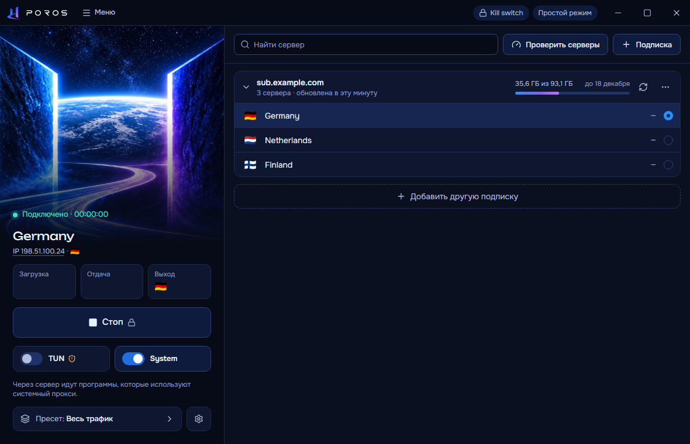
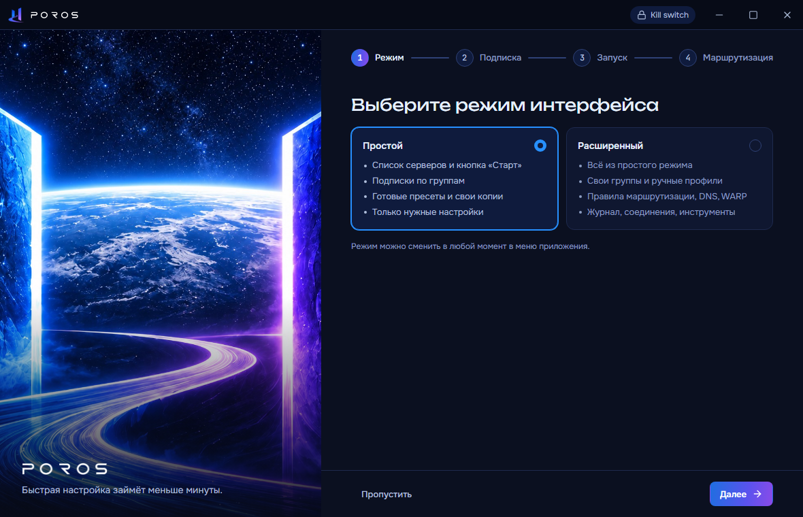
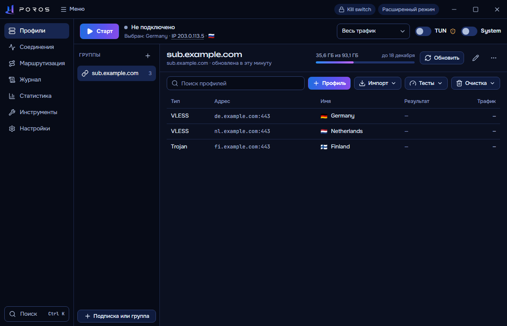
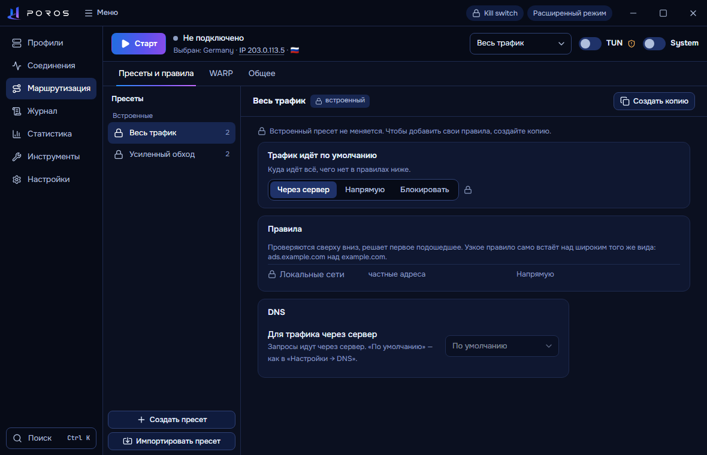
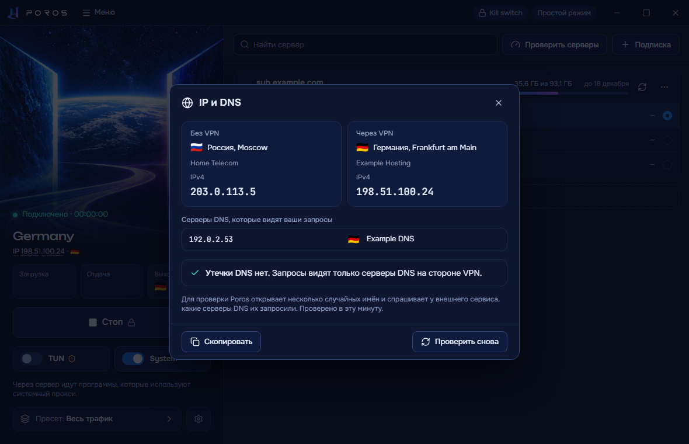

<div align="center">


# Project Poros

**Портативный клиент VPN и прокси для Windows**<br>
на [sing-box](https://github.com/SagerNet/sing-box) и [Xray-core](https://github.com/XTLS/Xray-core): простой режим на каждый день и расширенный со всеми настройками

[](https://github.com/tergride/poros/releases/latest)
[](https://github.com/tergride/poros/releases)
[](#скачать)
[](LICENSE)

[English](README.md) · **Русский**

[Скачать](#скачать) · [Возможности](#возможности) · [Для разработчиков](#для-разработчиков) · [Лицензия](#лицензия)



</div>

## Скачать

1. Скачайте `Poros-<version>-windows-amd64.zip` из [последнего выпуска](https://github.com/tergride/poros/releases/latest).
2. Распакуйте его в любую папку, где можно писать.
3. Запустите `Poros.exe`.

> [!NOTE]
> - Нужна 64-битная Windows 10 или 11, проверяется Poros на Windows 11. Ещё нужен WebView2 Runtime: в Windows 11 он встроен, а без него Poros предложит страницу загрузки.
> - Файлы не подписаны, поэтому Windows SmartScreen может остановить первый запуск: **Подробнее → Выполнить в любом случае**.
> - Для TUN нужны права администратора, и Poros запрашивает их через UAC, когда они понадобятся. Права получает только ядро, окно работает без них. Системный прокси работает без прав.

## Возможности

- **Простой режим:** мастер первого запуска, подписки и серверы с проверкой задержки, TUN и системный прокси по отдельности, пресеты маршрутизации со своими списками, проверка IP и утечки DNS.
- **Расширенный режим:** свои группы и профили, редактор профиля, цепочки, правила маршрутизации, конечные точки OpenVPN и OpenConnect, DNS и WARP, настройки входящих, TUN, протоколов, сети и безопасности, соединения, журнал и статистика трафика.
- **Протоколы:** VLESS с REALITY и XHTTP, VMess, Trojan, Shadowsocks и ShadowTLS, Hysteria и Hysteria2, TUIC, AnyTLS, WireGuard, Naive, SSH, Snell, SOCKS и HTTP, OpenVPN, OpenConnect, MASQUE. Подписки принимаются ссылками, в base64, Clash YAML и JSON sing-box или Xray.
- **Kill switch:** при обрыве соединения трафик VPN не уходит мимо сервера. По умолчанию он работает на время подключения, а можно оставить его включённым всегда. Он работает рядом с zapret и GoodbyeDPI: пока загружен их драйвер WinDivert, он работает в совместимом режиме: пропускает сырые пакеты TCP и UDP процесса Windows System, которыми драйвер отправляет пакеты заново, и отмечает это в заголовке окна.
- **Инструменты:** коды OTP, QR-коды, замер скорости, поиск Ctrl+K, горячие клавиши, резервные копии.
- **Система:** меню в трее с выбором пресета, запуск вместе с Windows, ссылки `poros://`, обновления.

<table>
  <tr>
    <td width="50%" align="center"><br><sub>Мастер первого запуска</sub></td>
    <td width="50%" align="center"><br><sub>Расширенный режим</sub></td>
  </tr>
  <tr>
    <td width="50%" align="center"><br><sub>Пресеты и правила маршрутизации</sub></td>
    <td width="50%" align="center"><br><sub>Проверка IP и утечки DNS</sub></td>
  </tr>
</table>

## Без установки

У Poros нет установщика. Его данные, включая профиль WebView2, хранятся в папке `config` рядом с `Poros.exe`, поэтому вместе с папкой удаляется и сам Poros. Если папка доступна только для чтения, Poros сообщает об этом и закрывается. Для одного пользователя Windows запускается один Poros.

## Обновления

Poros проверяет выпуски этого репозитория при запуске и каждые четыре часа, скачивает новую версию в фоне и ставит её, когда вы нажмёте **Перезапустить и обновить**. В разделе настроек «Помощь» автоматическую проверку можно выключить и включить бета-версии, здесь это пререлизы. Чтобы обновиться вручную, распакуйте новый архив поверх папки: папки `config` в нём нет, поэтому ваши данные останутся.

## Для провайдеров

Страница подписки может открыть Poros с этой подпиской. Ссылка — `poros://addsub/` и адрес подписки, в base64url без `=` на конце или как есть:

```js
const base64url = (text) =>
  btoa(String.fromCharCode(...new TextEncoder().encode(text))).replace(/\+/g, '-').replace(/\//g, '_').replace(/=+$/, '')

const link = 'poros://addsub/' + base64url(subscriptionUrl)
// или: 'poros://addsub/' + subscriptionUrl
```

Сам Poros ничего не добавляет: ссылка открывает окно добавления со вставленным адресом, а уже добавленную подписку предлагает обновить. Название после `#` в конце адреса (`https://example.com/sub#My%20VPN`, в том числе внутри base64) становится названием подписки навсегда и заменяет то, что провайдер передаёт в `Profile-Title`. Без него Poros показывает название провайдера и следует его изменениям. Poros принимает такие ссылки, когда их включил мастер первого запуска или **Настройки → Запуск**.

## Для разработчиков

### Сборка

Нужны рабочая нагрузка C++ из VS 2022 Build Tools и WebView2 Runtime, а также Go, Rust с целевой платформой MSVC и Node.js. Скрипт берёт их из одной папки: `go\go`, `gopath`, `rust` (внутри `rustup` и `cargo`) и `node`.

```powershell
script\build_windows.ps1 -Toolchain <папка>
```

Итог попадает в `deployment\windows-amd64`: `Poros.exe`, `PorosCore.exe`, `updater.exe` и `libcronet.dll`. Сборка без `POROS_VERSION` (`X.Y.Z`) остаётся без версии и сама не обновляется.

### Команды

| Команда | Что делает |
|---|---|
| `npm run dev` | Только интерфейс в браузере на `http://127.0.0.1:1420`, оболочка заменена заглушкой |
| `npm run tauri dev` | Окно приложения, интерфейс перезагружается при каждом изменении |
| `npm run typecheck` | `vue-tsc` по интерфейсу |
| `npm test` | Vitest |
| `npm run e2e` | Playwright в Chromium без окна против dev-сервера |
| `cargo clippy --manifest-path src-tauri/Cargo.toml` | Проверяет оболочку линтером |

### Устройство

| Папка | Что в ней |
|---|---|
| `src` | Интерфейс: Vue 3, TypeScript, Tailwind CSS, компоненты shadcn-vue, шрифты и картинки |
| `src-tauri` | Оболочка Tauri 2 на Rust: окно, трей, папка данных, мост к ядру |
| `core` | Ядро на Go: подписки, ссылки, конфигурации sing-box и Xray-core, подключение, проверка серверов, защита Kill switch, обновление |
| `third_party` | Копии модулей Go с правкой, которая нужна Poros, подробнее в его [README](third_party/README.md) |
| `e2e` | Проверки интерфейса на Playwright |
| `res` | Значки трея и JSON-схема sing-box |
| `script` | `build_windows.ps1` собирает портативную папку, `release_windows.ps1` публикует выпуск, `gen_schema.sh` заново создаёт `res/schema/sing-box.json` |

### Ядро и приложение

`Poros.exe` запускает `PorosCore.exe` из своей папки и общается с ним через именованный канал со случайным именем, который создаёт сам, только с одним экземпляром. Оба говорят на JSON-RPC 2.0, по одному сообщению в строке, и ядро ничего не отвечает до приветствия с токеном, который получило в командной строке. Интерфейс обращается к ядру только через оболочку. Методы и события ядра — типы Go в `core/engine/api.go`; `go tool tygo generate` в `core` записывает их в `src/platform/core-types.ts`, а модель сервера из `core/profile/profile.go` — в `src/platform/profile-types.ts`. Для `npm run tauri dev` переменная `POROS_CORE_PATH` указывает на собранный `PorosCore.exe`.

### Выпуски

`script\release_windows.ps1 -Toolchain <папка>` публикует самую новую версию из `CHANGELOG.md`, в разделе которой должны быть части `<!-- ru -->` и `<!-- en -->`, а в `src-tauri/Cargo.toml` — та же версия. Скрипт собирает эту версию, записывает в `THIRD-PARTY-NOTICES.txt` crates Rust, пакеты npm и модули Go сборки, упаковывает архив и `latest.json` — ленту, которую читает Poros, — и публикует их выпуском на GitHub, который остаётся черновиком, пока оба файла не загружены. Обычный выпуск делается из чистой `main`, совпадающей с `origin/main`, а `-Beta` публикует пререлиз из чистой `dev`, совпадающей с `origin/dev`. Обычный выпуск версии, которая уже вышла бетой из того же коммита, делает этот пререлиз последним выпуском без новой сборки. `-DryRun` собирает в `deployment\release` на любой ветке и ничего не публикует.

## Лицензия

Project Poros распространяется под лицензией GPL-3.0: см. [LICENSE](LICENSE).

Интерфейс использует шрифты [Onest](https://github.com/googlefonts/onest), [Unbounded](https://github.com/googlefonts/unbounded) и [JetBrains Mono](https://github.com/JetBrains/JetBrainsMono) под SIL Open Font License 1.1 и показывает флаги стран частью Noto Color Emoji (SIL Open Font License 1.1). Шрифты и тексты лицензий первых трёх лежат в `src/assets/fonts`.

[`THIRD-PARTY-NOTICES.txt`](THIRD-PARTY-NOTICES.txt) перечисляет проекты, которые входят в Poros, с их лицензиями. В архиве выпуска он также перечисляет все crates Rust, пакеты npm и модули Go сборки с файлами их лицензий.
